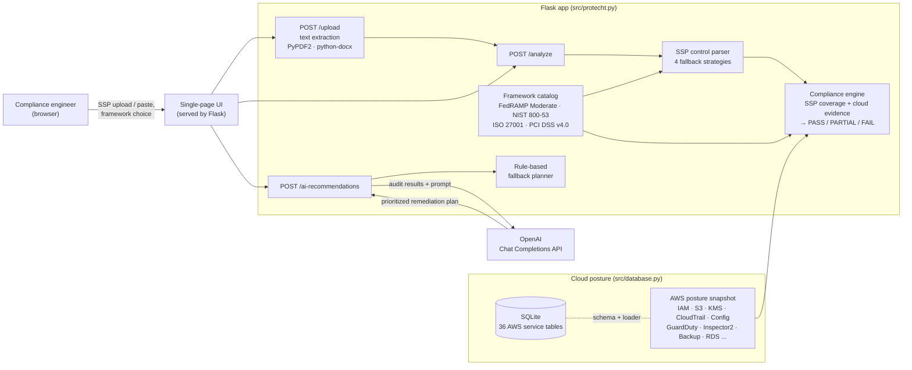

# proTecht

**Checks a System Security Plan against the cloud environment it describes, one control at a time, then turns the gaps into a remediation plan.**


---

## The problem

To sell to the U.S. government, a cloud provider needs FedRAMP authorization. Other frameworks apply too: NIST 800-53, ISO 27001 and PCI DSS. Each one means writing a **System Security Plan (SSP)**, a long document that explains how every security control is implemented.

The hard part is not writing the SSP. It's proving that the SSP is true. Today a compliance engineer or assessor reads each control description ("MFA is enforced for all users", "all S3 buckets block public access") and checks it by hand against the real cloud configuration. The work is slow and repetitive, and it's easy to miss things. The document also drifts away from reality as the infrastructure changes.

<!-- TODO (Harsh): add 1–2 sentences of first-hand context. For example, what you saw that motivated this (an internship, a class project, a conversation with a compliance team). Do not add numbers you can't source. -->

## What I built

proTecht is a web app and JSON API that automates the first pass of that review:

1. **Ingest the customer's document.** Upload an SSP as PDF, DOCX, TXT or Markdown, or paste the text. The app extracts the text server-side and deletes the uploaded file right away.
2. **Find the controls, even in messy documents.** SSPs don't follow one format, so the parser tries four extraction strategies in order: exact control-title patterns, then flexible control-ID formats (`AC-2:`, `AC-2 -`, `A.9.1`, `Req-8`), then control-family semantic keywords, then per-control keyword scoring. A `/debug-extraction` endpoint shows what each strategy found, which helps when a new document format doesn't parse.
3. **Score each control on two signals:**
   - *Documentation coverage.* Does the SSP text mention what the control requires (for example `mfa`, `rotation`, `retention`)?
   - *Cloud evidence.* Does the AWS security posture back up the claim? Checks include IAM users without MFA, password-policy length, S3 public-access blocks and encryption, CloudTrail trails, GuardDuty and Inspector2 critical findings, AWS Config rule compliance, AWS Backup coverage, and KMS/RDS encryption.

   The two signals combine into **PASS / PARTIAL / FAIL**, plus a confidence score, specific findings (for example `Public buckets found: dev-test-binaries`) and a recommended fix for each control.
4. **Generate a remediation plan.** The results go to OpenAI (`gpt-3.5-turbo`) with a compliance-expert prompt, which returns a prioritized plan. If no API key is set, or the call fails, a deterministic rule-based engine produces the plan instead, so the tool keeps working offline.

> **Current scope, stated plainly:** in this version the AWS posture comes from a **built-in sample snapshot** of a fictional GovCloud environment (`get_aws_data()` in `src/database.py`). There is a SQLite schema covering 36 AWS service tables and a `load_aws_data()` loader for storing collected posture, but the analysis does not yet call AWS APIs directly. Connecting a live collector (boto3, read-only IAM role) is the natural next step.
<!-- TODO (Harsh): if you publish the live boto3 evidence collector (it exists on the protecht-backend branch of the original repo), link it here and update the "Current scope" note. -->

## Architecture



## Key features

| Feature | Where in the code |
|---|---|
| Four compliance frameworks with per-control rules: FedRAMP Moderate (50 controls), NIST 800-53 Rev. 4 (19), ISO 27001:2013 (20), PCI DSS v4.0 (12) | `FRAMEWORKS`, `CONTROL_PATTERNS`, `COMPLIANCE_RULES` in `src/protecht.py` |
| Multi-format document ingestion (PDF, DOCX, TXT, MD), 16 MB limit, `secure_filename`, file removed right after extraction | `upload_file()`, `extract_text_from_file()` |
| Parser for inconsistently formatted SSPs, with four fallback strategies | `parse_ssp()`, `extract_controls_by_id()`, `extract_controls_by_semantics()`, `extract_controls_by_keywords()` |
| Evidence-based control scoring against AWS posture (MFA, password policy, S3 public access and encryption, CloudTrail, GuardDuty, Inspector2, Config, Backup, KMS/RDS encryption) | `check_compliance()` |
| LLM remediation plan with a deterministic fallback when no key is set or the API fails | `generate_ai_recommendations()`, `generate_basic_recommendations()` |
| Data model for cloud posture: 36 tables covering identity, storage, logging, detection, compute, network and CI/CD services | `ProTechtDatabase` in `src/database.py` |
| Extraction-debugging endpoint for onboarding new document formats | `POST /debug-extraction` |
| Configuration from environment variables only (no secrets in code) | `.env.example`, `main.py` |

### API

| Method | Path | Purpose |
|---|---|---|
| `GET` | `/` | Web UI |
| `GET` | `/frameworks` | Available frameworks and control counts |
| `POST` | `/upload` | Multipart file upload; returns extracted SSP text |
| `POST` | `/analyze` | `{"ssp_text": "...", "framework": "fedramp" \| "nist" \| "iso27001" \| "pci"}` → per-control results and a summary |
| `POST` | `/ai-recommendations` | `{"audit_results": {...}}` → remediation plan |
| `POST` | `/debug-extraction` | Shows what each parsing strategy extracted |
| `GET` | `/health` | Health check |

## Tech stack

- **Backend:** Python, Flask 2.3, Werkzeug
- **Document processing:** PyPDF2, python-docx
- **Data:** SQLite (`sqlite3`)
- **AI:** OpenAI Chat Completions API (`gpt-3.5-turbo`) over HTTPS via `requests`
- **Frontend:** a single HTML/CSS/vanilla-JS page served by Flask (drag-and-drop upload, framework selector, results and AI tabs)
- **Serving:** Flask dev server for local use; `gunicorn` is included for a production-style WSGI server

## Integrations / deployment

**How it connects to a customer's environment:**
- **Customer documents:** takes the SSP in whatever format the customer already has (PDF/DOCX/TXT/MD) and doesn't require a template.
- **Cloud posture:** the scoring engine reads a single posture dictionary (`get_aws_data()`). That dictionary is the integration seam. Its shape mirrors the AWS services an assessor checks (IAM, S3, KMS, CloudTrail, Config, GuardDuty, Security Hub, Inspector2, Backup, RDS, and more), and `ProTechtDatabase.load_aws_data()` stores a collected snapshot in SQLite. Today it returns a sample environment. A live collector only needs to fill the same shape.
- **Other systems:** every capability is a JSON endpoint, so results can feed a CI job, a ticketing workflow or a GRC tool without using the UI.
- **LLM:** set `OPENAI_API_KEY` to turn on AI-written remediation plans. Without it, the rule-based planner is used.

**Deployment:** this repository runs as a single Flask process. Run it in production mode with gunicorn:

```bash
gunicorn --chdir src -b 0.0.0.0:8000 protecht:app
```

<!-- TODO (Harsh): if this version was deployed anywhere (e.g., EC2, App Runner, Lambda), describe it here with the actual setup. The original repo's other branches include CloudFront/S3 frontend deploys and a Lambda package; only claim what you can show. -->

## Running locally

Requires Python 3.9+.

```bash
git clone https://github.com/Harsh-Sahay009/protecht-ssp-analyzer.git
cd protecht-ssp-analyzer

python3 -m venv venv
source venv/bin/activate          # Windows: venv\Scripts\activate
pip install -r requirements.txt

cp .env.example .env              # optional: add OPENAI_API_KEY for AI recommendations
python main.py
```


Open http://127.0.0.1:5000. The UI comes pre-filled with a sample FedRAMP SSP. Click **Analyze SSP**, then **AI Recommendations** for the remediation plan. A SQLite file (`protecht.db`) is created in the working directory on first run.

To try the API directly:

```bash
curl -s -X POST http://127.0.0.1:5000/analyze \
  -H 'Content-Type: application/json' \
  -d '{"framework":"nist","ssp_text":"AC-2: Account Management\nAccounts are managed in AWS IAM with MFA."}'
```

Configuration (`.env`):

| Variable | Default | Purpose |
|---|---|---|
| `OPENAI_API_KEY` | *(unset)* | Turns on LLM recommendations; without it the rule-based fallback is used |
| `HOST` | `127.0.0.1` | Bind address |
| `PORT` | `5000` | Port |
| `FLASK_DEBUG` | `0` | Set to `1` for the debugger and auto-reload (local only) |

## Screenshots

<!-- TODO: add screenshot/GIF of the upload screen with the framework selector and drag-and-drop area -->
<!-- TODO: add screenshot/GIF of the Control Analysis results (overall score + per-control PASS/PARTIAL/FAIL with findings) -->
<!-- TODO: add screenshot/GIF of the AI Recommendations tab -->

## Roadmap

<!-- TODO (Harsh): confirm or edit. These are suggestions based on the current code, not finished work. -->
- Live AWS evidence collection with boto3 and a read-only IAM role, in place of the sample snapshot
- Cloud-evidence checks for more controls (today 10 controls have AWS-specific checks; the rest are scored on SSP coverage only)
- Automated tests (`pytest` is in `requirements.txt` but the suite isn't written yet)

## Author

**Harsh Sahay** · [GitHub @Harsh-Sahay009](https://github.com/Harsh-Sahay009) · [LinkedIn](https://www.linkedin.com/in/harsh-sahay09/)

Licensed under the [MIT License](LICENSE).
